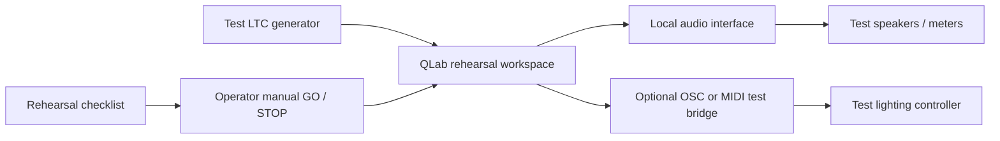

# Case Study — QLab cue construction, LTC synchronization and AV show control
**Classification:** original, synthetic QLab design exercise informed by author-reported shipboard experience. It is **not** an exported QLab workspace, a live show file or a claim of independently verified deployment.

## Professional context
The author reports QLab exposure, show playback and timecoded lighting/audio/video integration during cruise entertainment work (Saga, Nicko/Vasco da Gama, RWS/Marella and Ambassador). Exact workspace authorship, cue programming and employer permissions require independent evidence.

## Build a QLab demonstration workspace
**Goal:** build a repeatable 90-second rehearsal sequence in an isolated laptop/test rig. Use royalty-free/original media only.

1. Create a workspace named `DEMO_SHOWCONTROL_v1`; set audio output patch to a local test interface, not ship systems.
2. Import original audio assets `intro.wav`, `transition.wav` and `outro.wav`; normalize and check headroom without changing source originals.
3. Create cue groups: `PRESET`, `INTRO`, `TRANSITION`, `FINALE`, `ABORT`. Assign unique cue numbers.
4. Add Audio cues and Fade cues. Define pre-wait, post-wait and trigger behavior explicitly. Do not assume that a group mode will behave as expected without rehearsal.
5. Create a **test-only** LTC timecode reference and define frame rate (25 fps for this example). Map cue IDs to exact timestamps in the table.
6. Use Network/OSC or MIDI triggers only if supported by the local QLab edition and receiving test equipment. Document address and port as local placeholders, not vessel addresses.
7. Build an operator-safe `ABORT` group: fade playback to silence, stop pending cue sequences and switch to an approved manual recovery procedure. Never use an untested automation for emergency announcements.
8. Rehearse with stable LTC, missing LTC, late start, restart and duplicate triggers; record actual results.

## Illustrative cue sheet
| Cue ID | QLab cue type | Trigger | Expected action | Recovery |
|---|---|---|---|---|
| PRE-010 | Group | Manual GO | Prepare audio playback | STOP |
| AUD-100 | Audio | LTC 00:00:05:00 | Play original intro | Fade/STOP |
| LX-110 | Network/MIDI (optional) | LTC 00:00:05:00 | Trigger test lighting look | Manual GO |
| AUD-200 | Audio | LTC 00:00:28:00 | Play transition | Fade/STOP |
| AUD-300 | Audio | LTC 00:01:00:00 | Play outro | Fade/STOP |
| ABT-900 | Group | Manual only | Controlled abort sequence | Operator review |

## Signal and control architecture

## Verification matrix
| Test | Expected | Actual | Evidence |
|---|---|---|---|
| Correct LTC frame rate | Trigger on scheduled frame | NOT RUN | Screenshot pending |
| Missing LTC | No uncontrolled playback | NOT RUN | Screen recording pending |
| Late start | Controlled operator recovery | NOT RUN | Rehearsal log pending |
| Abort | Safe audio fade/stop | NOT RUN | Rehearsal log pending |
| Manual fallback | Operator can continue approved sequence | NOT RUN | Cue sheet pending |

## Leadership connection
This design converts an individual operator's knowledge into standardized cue documentation, operator training, cross-department integration tests and a repeatable handover process. It does **not** claim prior fleet-wide QLab deployment.

## Evidence needed before public release
Rights-cleared screenshots of a newly built demo workspace; original audio assets or license references; software/version details; actual test log; redacted employment credits.
